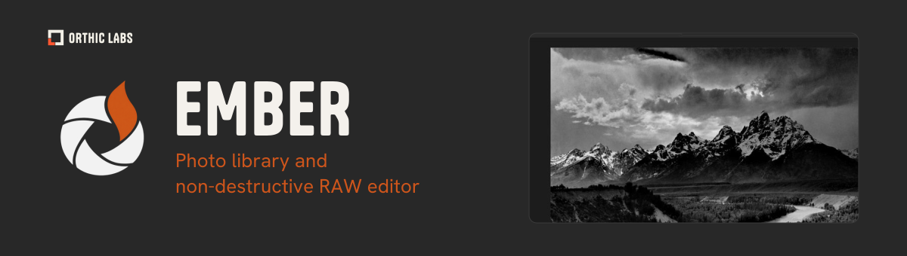

<sub>Banner: a crop of Ansel Adams’ public-domain photograph, from a historical LightCraft capture. [Image provenance](assets/ATTRIBUTION.md).</sub>

# Ember

Photo library & non-destructive RAW editor, maintained by **Orthic Labs**. Ember is based on [LightCraft](https://github.com/storytold/lightcraft) by ArtCraft Team & contributors, with our React/Tauri desktop workspace & RightKit integrations.

> **Development status:** no desktop artifact is qualified for release yet. React/Tauri targets macOS & Windows; [CI restoration](docs/ci-restoration.md) & [local AI delivery](docs/local-ai-delivery.md) track remaining qualification gates.

## Workspace

- **Library:** grid, bottom filmstrip, folders/albums, search, ratings, flags & metadata.
- **Develop:** left navigation & right editing panels, history, presets, crop, tone/color controls & masks. Rust processing stays authoritative; UI commands use shared engine contracts.
- **Import/export:** supported RAW & raster formats, XMP interoperability & LRCAT catalog import into an Ember library. Originals remain separate from non-destructive edits.
- **Automation:** engine commands, CLI/MCP & native control/hidden QA. [Control protocol](docs/control-protocol.md) documents interfaces.

React/Tauri targets **macOS & Windows**. Existing egui, Linux, web/WASM & CLI hosts remain in source. Format support & implementation gaps are tracked in [ROADMAP](ROADMAP.md) & [parity tracker](docs/parity.md); feature availability is not proof of reference editor parity.

<details>
<summary>Historical upstream editor screenshot</summary>

This capture shows LightCraft before Ember branding, not Ember’s React/Tauri workspace. See [showcase provenance](docs/showcase/README.md).


</details>

## Auto, masks & AI

- **Local editing:** deterministic [Auto tone](docs/auto-tone.md), measured [noise reduction](docs/noise-reduction.md) & sample-photo [look targets](docs/look-targets.md).
- **Culling & faces:** cancellable background analysis, paged review & explicit undoable acceptance. Face detection uses a separately downloaded YuNet model on Ember’s CPU ONNX interpreter. Face/eye & similarity weights remain unqualified; see [culling evaluation](docs/culling-evaluation.md) & [local AI delivery](docs/local-ai-delivery.md).
- **Denoise & masks:** React/Tauri uses classical denoise. An optional AI path exists in egui & CLI, with no bundled model or downloads ([denoise](docs/denoise.md)). [SAM 3 masking](docs/ai-masks.md) requires separately acquired weights under Meta’s licence.
- **Experiments:** CLI [OpenRouter assessment](crates/photo-ai/README.md) is opt-in & read-only; proposals never apply edits or delete/reject photos. No provider winner is validated. [Personal Auto](docs/personal-auto-evaluation.md) remains unqualified, a learned [Auto decision model](docs/auto-decision-model.md) is planned & ChatGPT-plan OAuth is deferred.


## Development & qualification

Ember’s React/Tauri workspace is maintained in this fork; no React/Tauri PR has been submitted to upstream LightCraft. Source integration targets upstream 0.7.0; see [integration record](docs/upstream-integration-2026-10-12.md) for the pinned revision & remaining work.

Public builds, Rust tests & native qualification run through generated **RightKit GitHub Actions** (`.rightgit.json`). Local work is source/static-only. Only qualified green artifacts are promoted to desktop default; source integration alone does not promote an installed app.

## Quick start

Rust workspace uses internal `lightcraft-*` crate/binary names for source & command compatibility. React source lives in `apps/lightcraft-desktop/web`; Tauri host lives in `apps/lightcraft-desktop`. RightKit versions are pinned by manifests & lockfiles; declarations alone do not establish integrated capabilities.

Install pinned frontend tooling & dependencies, then run local static checks:

```sh
corepack pnpm install --frozen-lockfile
pnpm typecheck
pnpm desktop:static
```

Use generated `ci` & `release-candidate` Actions lanes for compilation, eight Rust quality gates (fmt, clippy, heif, test, parity, layers, assets & WASM), frontend build & exact-artifact Mac/Windows hidden QA. [docs/releasing.md](docs/releasing.md) describes the upstream release pipeline, which runs only for `storytold/lightcraft`; the fork's candidate lane & its evidence are recorded in [CI restoration](docs/ci-restoration.md) & the [integration record](docs/upstream-integration-2026-10-12.md). [AGENTS.md](AGENTS.md) defines contribution & original-implementation rules.

## Documentation

[iOS & iPadOS architecture proposal](docs/ios-architecture.md) scopes native mobile editing, personal iCloud sync & later shared collections. Implementation follows mandatory RightKit owner qualification.

- [Branding & existing library/preferences compatibility](docs/branding.md)
- [Fork strategy & selective upstream absorption](docs/fork-strategy.md)
- [LRCAT catalog import](docs/lightroom-catalog-import.md)
- [XMP interoperability](docs/xmp-interop.md)
- [Library shortcuts](docs/library-shortcuts.md)
- [MCP](docs/mcp.md) & [native control protocol](docs/control-protocol.md)
- [Contributor credits](docs/contributors.md)

## Licence & attribution

Original upstream code is Copyright (c) 2026 ArtCraft Team & LightCraft contributors. Ember fork changes & original flame artwork are by Orthic Labs. Preserve [NOTICE](NOTICE), contributor provenance & [asset attribution](assets/ATTRIBUTION.md).

Code is **MIT OR Apache-2.0**, except `crates/segment` & `crates/fetch`, which are **Apache-2.0 only**; SAM model weights have separate terms & are not distributed here. See [LICENSE-MIT](LICENSE-MIT), [LICENSE-APACHE](LICENSE-APACHE) & [NOTICE](NOTICE). Inter uses SIL OFL 1.1. ArtCraft product marks have been removed; Ember is independently maintained.

---

<picture><source media="(prefers-color-scheme: dark)" srcset=".github/orthic-labs-mark.svg"></picture> **[Orthic Labs](https://orthiclabs.com)** · [github.com/Orthic-Labs](https://github.com/Orthic-Labs) · More: [Legion](https://github.com/Orthic-Labs/legion) · [SellRight](https://github.com/Orthic-Labs/sellright) · [SwiftRight](https://github.com/Orthic-Labs/swiftright) · [Pulse](https://github.com/Orthic-Labs/pulse) · [RightKit](https://github.com/Orthic-Labs/rightkit) · [RustRight](https://github.com/Orthic-Labs/rustright)
