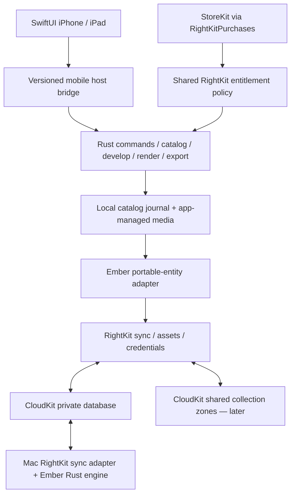

# Ember iOS & iPadOS architecture

**Status:** design proposal · 2026-10-13; local-first V1 slice built 2026-10-19 (below). Sync, StoreKit, shared collections and the remaining RightKit owner adoption still follow the sequence in this document. Rust remains authoritative; SwiftUI supplies native mobile presentation. Android is outside scope.

**Last updated: 2026-10-25.**

## Built so far (2026-10-19)

| Piece | Where | State |
|---|---|---|
| Rust bridge | `crates/mobile` (`lightcraft-mobile`, UniFFI 0.32, same as `rightkit-android`) | `EmberSession` wraps `DesktopHandle`: `open`, `run(id, paramsJson)`, `snapshot`, `viewSlice`, `preview`/`previewQuick` → descriptor, `previewBytes(handle)`, `releasePreview`, `preferences`, `persist`, `close`; contract version `bridgeVersion() == 1`. JSON shapes are desktop-host's. Pixels travel as encoded bytes, never JSON. Malformed input returns `EmberError`; tests cover it. |
| XCFramework | `scripts/ios/build-xcframework.sh` (macOS) | Builds `aarch64-apple-ios` + `aarch64-apple-ios-sim` static libraries (dev profile by default) into `ios/Frameworks/EmberCore.xcframework` and generates the Swift bindings into `ios/Ember/Generated/` (both gitignored). Without SAM (`default-features = false`). |
| App | `ios/Ember` (XcodeGen `ios/project.yml`) | Library chooser (user-chosen folder per D6, remembered by security-scoped bookmark, or the procedural sample library) → adaptive grid with rating/flag/edited badges → viewer with stars, pick/reject, touch-and-hold before/after → Edit panel (bottom on iPhone, side inspector on iPad) whose Light / Color / Effects / Vignette sliders come from the Rust control specs; a slider gesture is one undo step (`develop.beginInteraction`/`endInteraction`), undo/redo, double-tap resets → Share exports a JPEG through `app.export`. Imports from Photos or Files copy into `<library>/Originals/` and import by path. Catalog persists when the app backgrounds. |
| Tests | `crates/mobile` unit tests; `ios/EmberUITests` | Bridge: malformed requests, demo session slice/rate/edit/render. UI test: chooser → sample library → rate → pick → edit exposure → undo, with screenshots in the result bundle. |

**Shared components (Rk3 Win rulings, `ios-349/RULINGS.md`, relayed 2026-10-19).** There is no mandatory iOS owner list; RightKit's mandatory set is desktop-only and the Apple profile is an unratified draft. Ember pins RightKitSwift **0.8.1** and adopts only products covering what it does (licence, Apple credentials, diagnostics, store). The licence device id is RightKit's Keychain `requireDeviceID` (fails closed); 0.9.0 (held) adds its seed/accessibility/corruption options, the licence ContinuityBridge, `SyncedCredentialPolicy`, RightKitAccount, RightKitHTTP + NetPolicy, RightKitOAuth and RightKitHelperProtocol: move to them when tagged. Never built inside Ember: licence/Pro bridge, device-id store, account sign-in, HTTP client or URL policy, synced-credential policy, OAuth/PKCE, CoreML model root (HeardRight's SharedModelRoot), LAN send (Pulse's SendKit), signing/archive/TestFlight scripts.

**TestFlight route (not run yet).** App Store Connect record exists: "Ember by Orthic Labs", app id 6824279883, bundle `com.orthiclabs.ember`, SKU `ember-ios`, internal TestFlight group. Releases go through right-release #349 (rightkit `docs/IOS-PACKAGE-RECIPE.md`, `targets.ios.iosPackage`; recipe fixes on rightkit main 44125396), run in the Mac desktop (Aqua) session, dry run first and reviewed by Rk3 Win before `--apply`. Still needed: an original 1024 px opaque AppIcon asset catalog (with its `assets/ATTRIBUTION.md` entry), `targets.ios.cargoManifest`/`ownershipScope` for the linked Rust library, a one-off RustRight `ios-static` exception for the release library, and a version bump before every sealed rebuild. Known gap: rightkit#780 (iOS build path assumes a Tauri layout).

Not yet: personal sync, StoreKit, shared collections, keywords/albums UI, crop/rotation UI, presets, named versions, masks, RAW-format reporting, background-task progress UI beyond the busy overlay, device/oldest-hardware performance measurements. The existing RightKit owners (licence, credentials, diagnostics, store) stay wired as before.

## Current local-first app

The current iOS app opens a user-selected library folder or procedural sample library, imports images from Photos or Files into `Originals/`, & browses photos in a grid with rating, flag & edited badges. The viewer supports star ratings, pick/reject, press-and-hold before/after, & an Edit panel. Light, Color, Effects & Vignette controls come from Rust control specs; edits support undo/redo & double-tap reset. Share exports a JPEG through `app.export`.

The iPad sidebar, filmstrip, keyboard commands & Pencil support are not implemented. Other mobile features still to build are listed above.

Later stages add advanced masking, large-library refinement, qualified AI, HDR & collaborative collections. Shared collections follow personal-sync qualification. Simultaneous live brush editing is outside initial scope. No learned feature is promised merely because corpus preparation exists.

## Runtime & authority

One mobile host owns one Rust session per open library. SwiftUI state stays on `MainActor`; bounded command, decode & render queues run away from main thread. Callback arrival never directly mutates UI or catalog. Cancelled/replaced previews carry generations; stale results are discarded.

Reuse contracts in `crates/desktop-host/src/lib.rs`: command dispatch, snapshots, generation-aware `view_slice`, previews, preferences, persistence & orderly shutdown. Factor portable session/controller responsibilities from desktop-specific polling, auto-import & process-exit behavior. React/Tauri desktop presentation remains intact.

A versioned bridge exposes typed requests/responses, cancellation, progress, structured errors & preview handles. Large pixels stay outside JSON; descriptors carry dimensions, stride, colour space, generation & explicit lifetime. No panic crosses ABI boundary.

Generated CI will package Rust device/simulator libraries as an XCFramework. `aarch64-apple-ios` & `aarch64-apple-ios-sim` are supported Rust targets; Ember linking/runtime qualification remains future work. [Rust platform support](https://doc.rust-lang.org/rustc/platform-support.html)

Bridge ownership is pending RightKit audit. Prefer shared native adapter/generation support. Any required ABI glue belongs behind isolated safe APIs; current production `unsafe` restrictions cannot silently expand. Mobile in-process supervision must be a qualified RightKit owner adapter, rather than copying desktop child-process supervision into Ember. [#212](https://github.com/Orthic-Labs/ember/issues/212)

## Portable data, separate from local catalog

Keep Rust catalog journal/snapshot format. `crates/catalog/src/lib.rs` makes `Op` mutations authoritative for replay, undo & recovery. CloudKit carries portable entities, never replicas of device-specific `catalog.snap` or `catalog.log`.

Current photo/album/stack IDs are local `u64`s; file sources contain local paths. Introduce stable portable UUIDs mapped to existing IDs, preserving old catalogs. Entity envelope carries schema, library/collection identity, entity/revision UUIDs, parent revision IDs, originating device & optional author identity.

Portable entities cover photo identity/original digest/capture metadata, collections & membership/order, ratings/flags/keywords, immutable develop revisions, named versions/virtual copies, media/mask asset manifests, deletion state & conflict references. Device paths, Photos identifiers, security-scoped bookmarks, model locations, selection, window preferences & caches stay local.

Rust owns domain validation, migration & reconciliation. RightKit owns transport, cursors, account fences, retries & durable delivery. Cloud records cannot insert unvalidated settings into catalog. Incoming page acknowledgement follows durable apply; catalog commit & outgoing queue must be crash-consistent, through journal-backed/replay-derived publication.

## Original media & proxies

Imports copy selected media into app-managed storage, preserving source files. Native Photos picker is initial route; broader library permission is requested only for workflows requiring it. Files access remains scoped to transfer. Export writes new output.

Cloud membership is explicit per collection. Metadata & bounded thumbnails synchronize first; original upload/download follows chosen storage policy. Available Offline pins required media & confirmed local edits. Eviction never deletes sole original or an unuploaded edit. Corpus/training folders are excluded from automatic product sync.

A JPEG thumbnail supports browsing/rating/metadata; it does not become RAW editing source. Editing needs original or a qualified editable proxy. Later proxy optimization uses Rust-generated scene-linear source, original digest, orientation, colour/decode fingerprint & format version. Sensor-dependent detail, demosaic, RAW denoise & original-quality export require original. UI states proxy/export resolution.

RightKit assets need file-backed streaming, checksums, limits & cancellation. Current `SyncValue.asset(Data)` eagerly materializes bytes; it cannot serve large RAW transport unchanged.

## Edit synchronization & conflicts

Completed edit gesture commits immutable revision with complete `DevelopSettings`, process/schema versions & masks. Slider motion stays transient/local; cloud publishes committed gestures. Named versions reference immutable revisions.

Parentage establishes causality without trusting device clocks. Independent metadata edits can merge per field using ancestry & deterministic ties. Concurrent develop edits create branches; retain both & show Edited on another device. User selects branch or explicitly merges. Never silently combine competing crop geometry or mask arrays.

Masks remain atomic inside revision for V1. Normalized coordinates preserve portability; raster payloads reference immutable checksummed assets with source/model provenance. Local mask IDs remain meaningful only within their revision.

Unsupported future settings/process versions become read-only, preserving original payload & requesting compatible update. Existing engine process-version fallback is insufficient for claiming identical cross-device rendering; mobile compatibility guard is required before editing. See [process versions](process-versions.md).

Publish payload dependencies before head reference; incomplete revisions remain pending/invisible. Recently Deleted is reversible lifecycle state, separate from irreversible tombstone. Restore may need fresh identity under current RightKit permanent-tombstone semantics. Delete-versus-edit preserves losing edit in recovery branch without resurrecting deleted membership. Original deletion remains explicit storage operation.

## Same person versus different users

Personal sync joins Mac/iPhone/iPad using same CloudKit container/schema & iCloud account, with independent local replicas. Orthic login & App Store purchases do not select iCloud identity. Apple distinguishes private, public & shared databases. [CloudKit databases](https://developer.apple.com/documentation/cloudkit/ckdatabase)

Cross-user collaboration uses CKShare with dedicated collection zone in owner's private database; participant reads granted records through shared database. Keep unrelated private photos outside shared zone. Shared export omits private GPS/captions unless owner includes them. [Apple shared records](https://developer.apple.com/documentation/cloudkit/shared-records)

Sharing UI covers invitation, acceptance, participants, read-only/edit permissions, leave & revoke. Rust checks effective permission at command boundary; CloudKit checks remote authorization. Offline edits after revocation become private recovery branch & cannot upload. Revocation cannot recall independently exported recipient files. Removing share does not delete separately imported originals.

RightKit must extend shared-database scope, owner-qualified zone IDs, invitation lifecycle, permissions & revocation. Evaluate Apple's CKSyncEngine within shared owner; Ember adds no competing transport.

## StoreKit & access

Use `RightKitPurchases` for verified transactions, updates, restore & cached ledger; `RightKitLicense` supplies shared policy. Rust checks protected command entitlement. iCloud data identity, App Store purchase identity & optional Orthic account/license remain separate.

`appAccountToken` associates purchases with developer-account identity; it grants neither iCloud identity nor sharing permission. [Apple appAccountToken](https://developer.apple.com/documentation/storekit/product/purchaseoption/appaccounttoken(_:))

Refund/revocation changes access without deleting library or blocking recovery/export of owned work. Verified current entitlements exclude revoked/refunded products; offline expiry follows settled product policy. Shared album membership does not transfer paid access. Family Sharing is separately configured. [Apple current entitlements](https://developer.apple.com/documentation/storekit/transaction/currententitlements)

Mac/iOS universal purchase needs corresponding App Store Connect arrangement; direct Mac/Windows licensing needs explicit verified bridge. HeardRight's mobile/full split is evidence of distinct policies, not Ember pricing decision. [Apple universal purchase](https://developer.apple.com/help/glossary/universal-purchase)

Windows initially retains local catalog & portable transfer bundles with originals/proxies/manifests/revisions. Existing macOS CloudKit helper is not Windows transport. Future cross-platform synchronization extends RightKit after identity & sharing qualification.

## Shared ownership & current gaps

| Capability | Owner to reuse | Work before implementation |
|---|---|---|
| Photo commands/catalog/develop/render/export | Ember Rust engine & desktop-host contracts | Factor portable host; mobile bridge |
| Cloud delivery | `rightkit-sync`, `RightKitCloudSync` | Causal heads, compare-and-save, shared zones, file-backed assets |
| Commerce/access | `RightKitPurchases`, `RightKitLicense`, `rightkit-license` | Unified explicit mobile/Mac/Windows policy |
| Credentials | `RightKitAppleCredentials`, `rightkit-credentials` | Account-switch isolation; native adapters |
| Settings | `rightkit-app-settings` & native owner adapter | Common schema, device/cloud distinction |
| Jobs/files/storage | `rightkit-job-queue`, `rightkit-fs`, `rightkit-db` where applicable | Mobile adapters; preserve Rust domain catalog |
| Diagnostics | `RightKitDiagnostics`, logs/crash owners | Native hooks, redaction, bounded retention |
| Presentation | SwiftUI + qualified shared native UI owner | Navigation, accessibility & mobile frame |
| Release/QA | Generated RightKit Actions/release/QA | Device/simulator/XCFramework/distribution qualification |

Complete mandatory adoption also covers shell/frame, service/data locations, messaging/CLI, legal/onboarding, HTTP, updates, MCP, test-mode & release-switch enforcement. Current Mac owner list is pending, not an approved exemption for mobile. Desktop package APIs cannot simply be assumed available on iOS. Every portable/native profile must retain shared ownership, with product-specific photo behavior in Ember.

Source findings: current CloudKit transport uses private database/custom zone; authoritative `.allKeys` writes & date-based merge defaults need extension for concurrent photo edits. Cloud-sync ownership index reports staged/declaration-only; product presence is not qualification.

HeardRight evidence: `ios-native/HeardRight/TranscriptCloudSync.swift` composes shared engine with transcript adapter; `StoreKitProController.swift` wraps shared purchases. Its native production paths remain in progress. Reuse infrastructure boundaries, not transcript merge policy or pricing. Source lookup used local `D:\Claude\heardright` & `D:\Claude\rightkit`; Mac mandatory audit came from Update RightKit app requirements chat, `01a12eef-a184-7df1-942d-9f7301866854`. No implementation effects were delegated or run.

## Qualification & sequence

After mandatory owner closure: qualify bridge/local import/edit/export → personal sync → shared collections. Minimum OS, oldest supported hardware, commerce policy & original-storage defaults remain product decisions before implementation; no guessed deployment floor is encoded.

Generated CI binds source revision, package versions, XCFramework hashes & native artifact identity. Test real iPhone/iPad/Mac pairs, separate iCloud users, offline conflicts, future schemas, account switch, interrupted transfer, cloud quota/full disk, malformed media, permissions/revocation & StoreKit restore/refund.

Measure opening, draft slider latency, export, memory & thermal behavior on selected oldest device. Existing draft/loupe budgets become measured mobile targets, not claimed results. Bound decode concurrency; GPU failure has CPU fallback.

Foreground resumes synchronization promptly; background delivery follows iOS scheduling. Persist completed edits before suspension & expose pending transfer state. [Apple background strategies](https://developer.apple.com/documentation/backgroundtasks/choosing-background-strategies-for-your-app)

Acceptance: restart recovery, preserved originals, deterministic revision convergence, retained conflict branches, enforced permissions & matching qualified Rust renders. Release only qualified native artifacts through settled RightKit ownership chain.
